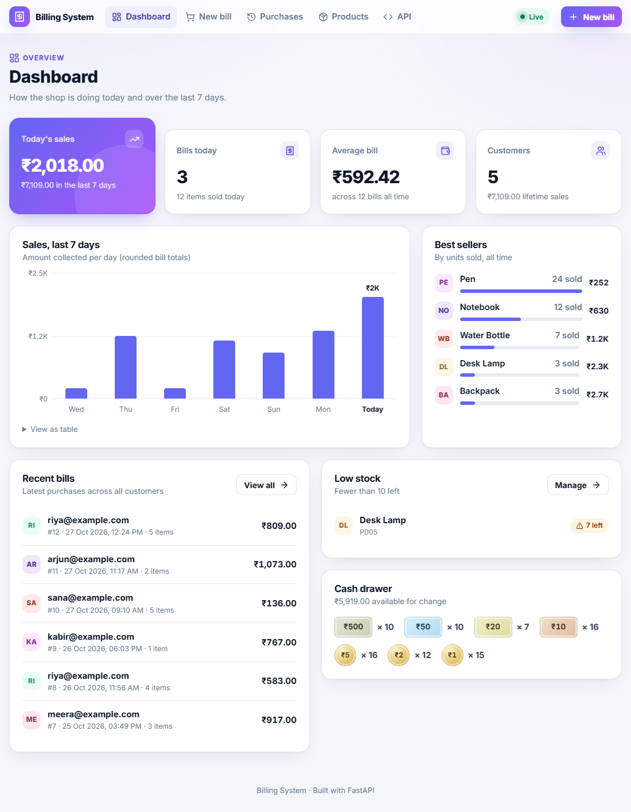
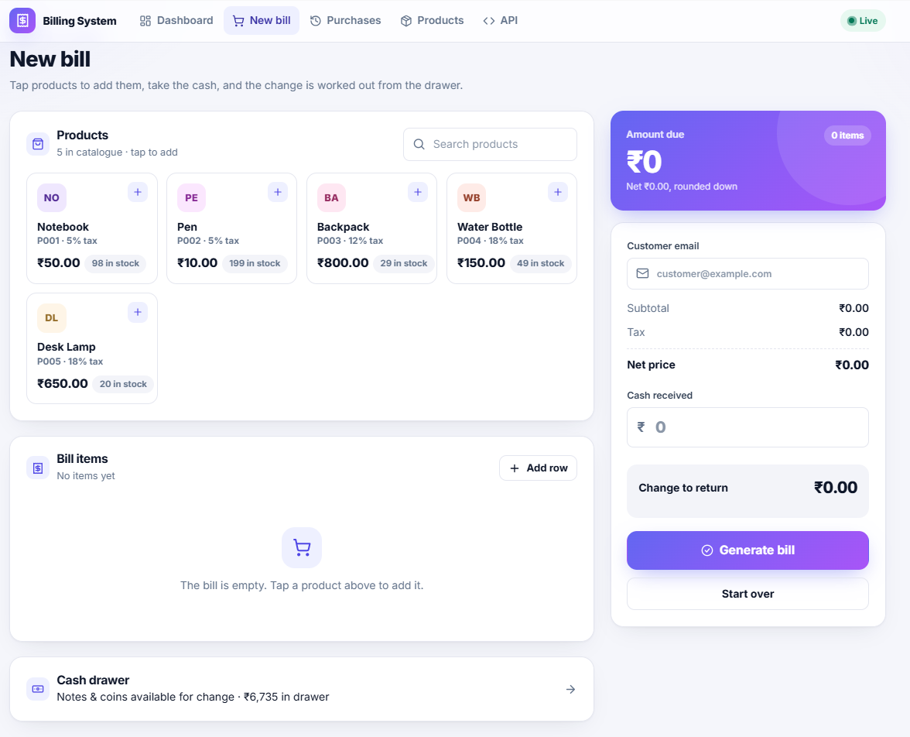
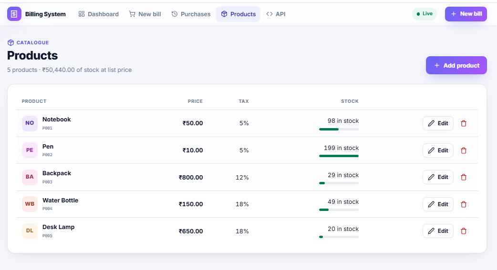
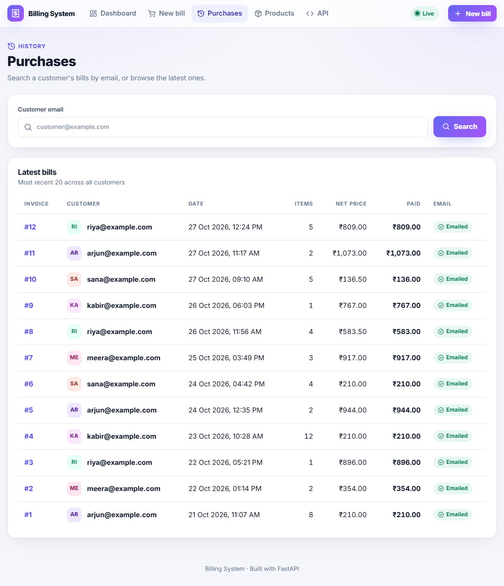

# Billing System


A billing app for a small shop, built with FastAPI. You pick products, take cash, and it works out the tax, the amount due and the change. The change only uses the notes and coins actually in the drawer. The customer gets the invoice by email.

It runs on your own computer. There's no login and nothing to sign up for: start it, open the browser, and it's ready with sample products.



| New bill | Products |
| --- | --- |
|  |  |

<details>
<summary>Purchases page</summary>



</details>

## What it does

- Billing page where you tap products to add them, adjust quantities and see the change before you submit
- Tax is calculated per item, and the final amount is rounded down to the rupee
- Change is worked out from the drawer's stock. If the drawer can't make the exact change (say it has one ₹50 and three ₹20s and you owe ₹60), it still finds a way. If it really can't, the bill records how much is short.
- The customer's cash goes into the drawer before change is worked out, so their own notes can come back as change. The cashier can say which notes were handed over; otherwise the fewest notes are assumed (₹600 is taken as one ₹500 and one ₹100).
- The drawer handles every note and coin in everyday use: ₹500, 200, 100, 50, 20, 10, 5, 2 and 1
- A bill is saved all at once or not at all, so stock and drawer counts never get half-updated
- Two tills can't sell the last item twice. Stock is taken with a conditional update, so if two bills race for the last unit, one goes through and the other is told it just sold out.
- Invoices are emailed in the background. If email isn't set up, they're saved as files in `data/sent_emails/` instead.
- Dashboard with today's sales, a 7-day chart, best sellers and low stock
- Purchase history per customer, and printable invoices
- Pages update by themselves when something changes, so you don't need to refresh. This uses Server-Sent Events.
- Products can be added and edited from the UI or through the JSON API

## Running it

You need [Python](https://www.python.org/downloads/) 3.11 or newer (I use 3.14) and Git.

**Windows (PowerShell)**

```powershell
git clone https://github.com/Mallikarjun202/billing-system.git
cd billing-system
py -m venv .venv
.venv\Scripts\Activate.ps1
pip install -r requirements-dev.txt
copy .env.example .env
uvicorn app.main:app --reload
```

**macOS / Linux**

```bash
git clone https://github.com/Mallikarjun202/billing-system.git
cd billing-system
python3 -m venv .venv
source .venv/bin/activate
pip install -r requirements-dev.txt
cp .env.example .env
uvicorn app.main:app --reload
```

Then open http://127.0.0.1:8000. Next time you only need the `Activate` line and the `uvicorn` line.

### First time using it

1. Open **New bill**, tap a couple of products, type any email (e.g. `test@example.com`) and click one of the cash buttons.
2. Click **Generate bill**. You'll land on the invoice.
3. Look at **Dashboard** and **Purchases**. Your bill is there. Keep two tabs open and make another bill to see them update on their own.

You don't need to set up email to try it. Without it, invoices are saved as files in `data/sent_emails/` and the badge says "Saved to outbox".

The database (`data/billing.db`) is created on the first run with 5 sample products. To start over with a clean shop, stop the server and delete the `data` folder.

### If something goes wrong

- **"running scripts is disabled on this system"** when activating on Windows: run `Set-ExecutionPolicy -Scope CurrentUser RemoteSigned` once, then try again.
- **`py` or `python` is not recognized**: Python isn't installed or isn't on PATH. Reinstall it and tick "Add python.exe to PATH".
- **Port 8000 is already in use**: run it on another port, e.g. `uvicorn app.main:app --reload --port 8001`.
- **Email shows "Email failed"**: the invoice page shows the reason. Usually it's a wrong App Password; see below.

## Email setup (optional)

To send real emails through Gmail:

1. Turn on 2-Step Verification for your Google account.
2. Create an App Password at https://myaccount.google.com/apppasswords. Your normal Gmail password won't work.
3. Fill in `.env`:

```
SMTP_HOST=smtp.gmail.com
SMTP_PORT=587
SMTP_USER=you@gmail.com
SMTP_PASSWORD=your16letterpassword
SMTP_FROM=you@gmail.com
```

4. Restart the server.

`.env` is in `.gitignore`, so the password never gets committed. Put your details in `.env`, not in `.env.example`, which is the shared template. If sending fails, the invoice page shows the reason and lets you try again.

Other settings: `DATABASE_URL` (default is SQLite in `data/`), `CURRENCY_SYMBOL` (default ₹) and `SMTP_USE_SSL` (set it to `true` if you use port 465).

## API

Everything the pages do is also available as a JSON API. The interactive docs are at http://127.0.0.1:8000/docs, where you can try each endpoint in the browser.

| Method | Path | What it does |
| --- | --- | --- |
| GET, POST | `/api/products` | List products, add one |
| GET, PATCH, DELETE | `/api/products/{id}` | Get, update or delete a product |
| GET, PUT | `/api/denominations` | See or set the drawer's notes and coins |
| POST | `/api/bills` | Make a bill (optional `cash_notes` says which notes the customer gave) |
| GET | `/api/purchases?email=` | A customer's purchases |
| GET | `/api/purchases/{id}` | One purchase with items and change |
| GET, POST | `/api/purchases/{id}/email` | Check the invoice email status, or resend it |
| GET | `/api/events` | Live update stream |

Example:

```bash
curl -X POST http://127.0.0.1:8000/api/bills -H "Content-Type: application/json" -d '{
  "customer_email": "customer@example.com",
  "items": [{"product_id": "P001", "quantity": 2}, {"product_id": "P003", "quantity": 1}],
  "cash_paid": 1100
}'
```

## Bugs I found and fixed

Going back over the code with concurrent tests turned up three real problems:

- **The drawer only ever lost money.** Change was taken out, but the customer's cash was never put in. After a day of sales the app would refuse to give change it physically had. A test now checks that the drawer grows by exactly the amount the shop keeps.
- **Two tills could sell the same last item.** Stock was read, checked, then written back as a new number. With 8 bills racing for 1 item, all 8 succeeded. `tests/test_concurrency.py` reproduces it: the old code records 8 sales of a single item, the new code records 1.
- **No ₹100 or ₹200 notes.** Change for ₹100 came back as two ₹50s. Existing databases get empty slots for the new notes on startup.

## Known limitations

- Money is calculated with `Decimal` but stored in `Float` columns. The values are rounded to two places before saving, so it's fine at shop scale, but a `Numeric` column would be the right type. Changing it needs a migration.
- There's no login. It's meant to run on the shop's own computer, not on a public server.
- SQLite allows one writer at a time. Fine for one or two tills; use Postgres via `DATABASE_URL` for more.

## Code layout

```
app/
  main.py        app setup
  config.py      settings from .env
  database.py    database connection
  models.py      tables
  schemas.py     request and response models
  billing.py     tax, rounding, change, saving a bill
  emails.py      invoice emails
  events.py      live updates
  dashboard.py   dashboard numbers
  seed.py        sample data
  routers/       web pages and the JSON API
  templates/     HTML and email templates
  static/        CSS and JavaScript
tests/           pytest tests, including a concurrency test
docs/            screenshots for this README
```

Built with FastAPI, SQLAlchemy, Pydantic, Jinja2 and SQLite. The frontend is plain HTML, CSS and JavaScript with no build step.

## Tests

```bash
pytest
```

The tests use a temporary database and never send real email. They also run on GitHub for every push; that's the badge at the top.

## Notes

- There's no login, so it's meant for running on your own computer or shop network. Don't put it on the public internet as it is.
- Live updates assume a single server process. Running several workers would need something like Redis to share the events.
- Times are stored in UTC and shown in the server's local time.
